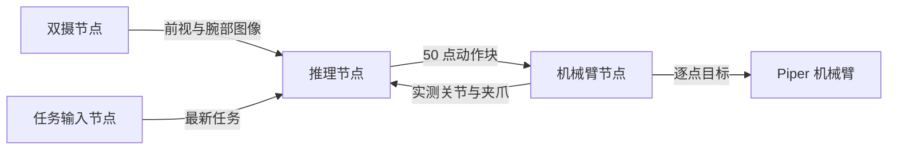

# 运行与参数说明

## 一、节点与数据流



`inference.launch.py` 启动双摄与推理节点，`robot.enabled: true` 时再启动机械臂节点。任务节点由独立终端运行：

```bash
ros2 run pi05_inference prompt_node
```

输入一行任务并按回车发布，再输入下一行切换。节点存储最后一条任务，推理节点连接后可以收到该任务。

串行模式完成当前 50 点发送后再预测；下一块使用最新任务。如果任务在推理期间变化，该次旧任务结果会被丢弃。

## 二、串行轨迹处理

1. 从最新双摄图像与实测状态生成 50 个动作目标。
2. 对 J1–J6 做三阶差分惩罚拟合，减少轨迹的急剧变化。
3. 在末段依据五点窗口的方向一致程度，逐渐保留模型原始目标。
4. 对小范围、反复变向且首尾位置接近的片段做局部压平。
5. 从当前反馈出发，逐点限制单个关节的目标角度变化。
6. 按 `command_hz` 发送整块目标，再读取新观测预测下一块。

这些处理保留动作点数。夹爪不参与关节拟合与每步角度限制，实际开合范围由 SDK 控制。

| 参数路径，位于 `execution.serial` | 当前值 | 含义 |
|---|---|---|
| `command_hz` | 60.0 | 每秒发送目标的数量 |
| `trajectory_fit.jerk_penalty_weight` | 0.20 | 三阶差分惩罚强度 |
| `trajectory_fit.terminal_preserve_points` | 10 | 末段按方向一致程度减少拟合改动的点数 |
| `trajectory_fit.jitter_range_deg` | `[0.06, 0.07, 0.10, 0.12, 0.11, 0.10]` | J1–J6 的五点抖动总范围，单位为度 |
| `trajectory_fit.jitter_net_ratio` | 0.25 | 窗口首尾净变化与总变化量的比例上限 |
| `trajectory_fit.max_joint_step_deg` | 1.75 | 单个关节相邻发送目标的最大角度差 |

末段连续同向变化时，原始目标的保留程度逐渐提高；反复变向时继续保留平滑效果。压平要求五点范围不超过该关节阈值，至少有三次有效变化、两次变向，并满足净变化比例条件。

发送频率控制目标更新节奏，`motion_speed` 控制 SDK 的速度比例，`state_publish_hz` 控制反馈发布频率。三者职责独立。

## 三、RTC 执行

| 参数，位于 `execution.rtc` | 含义 |
|---|---|
| `command_hz` | RTC 动作目标的发送频率 |
| `replanning.request_after_points` | 当前计划执行多少点后请求新预测 |
| `replanning.initial_latency_seconds` | 首次 RTC 请求的预计耗时 |
| `guidance.model_directory` | 梯度计算分片目录 |
| `guidance.max_guidance` | RTC 去噪引导系数上限 |

请求时记录尚未发送的目标与当前控制点编号。返回时按实际经过的控制点数量丢弃新预测的过期前缀，再替换旧队列尚未发送的未来目标。代码不在返回后对新旧关节目标额外加权混合。

串行与 RTC 的模型接口不同。当前串行 `part2.om` 含 FP16 更新输出；RTC 需要匹配的动作图、`manifest.json`、`euler.json` 和 `part_00.om` 等分片。

## 四、ROS2 接口

| 配置键 | 默认名称 | 类型 | 用途 |
|---|---|---|---|
| `topics.prompt` | `/pi05/prompt` | `std_msgs/String` | 任务输入 |
| `topics.front_image` | `/pi05/video/front` | `sensor_msgs/Image` | 前视图像 |
| `topics.wrist_image` | `/pi05/video/wrist` | `sensor_msgs/Image` | 腕部图像 |
| `topics.state` | `/joint_states` | `sensor_msgs/JointState` | 实测状态 |
| `topics.action` | `/pi05/action_chunk` | `trajectory_msgs/JointTrajectory` | 模型动作块 |
| `topics.latency` | `/pi05/input_latency` | `std_msgs/String` | 输入与推理耗时 |
| `topics.robot_status` | `/pi05/robot_status` | `std_msgs/String` | 动作发送状态 |
| `topics.model_status` | `/pi05/model_status` | `std_msgs/String` | 模型加载与就绪状态 |
| `topics.rtc_request` | `/pi05/rtc_request` | `pi05_interfaces/RTCRequest` | RTC 请求 |
| `topics.rtc_action` | `/pi05/rtc_action` | `pi05_interfaces/RTCAction` | RTC 返回结果 |

ROS2 状态中的六关节单位为弧度，夹爪单位为米；进入模型前转换为度和毫米。执行前转回 SDK 使用的单位。

### 机械臂服务

| 服务 | 类型 | 功能 |
|---|---|---|
| `/pi05_robot/stop` | `std_srvs/Trigger` | 停止目标发送并请求普通待机 |
| `/pi05_robot/prepare` | `std_srvs/SetBool` | 准备机械臂；`data: true` 允许控制器恢复操作 |

```bash
ros2 service call /pi05_robot/stop std_srvs/srv/Trigger '{}'
ros2 service call /pi05_robot/prepare std_srvs/srv/SetBool '{data: true}'
```

正常完成一个动作块后，节点返回可预测状态并继续下一块。任务语义上的“已完成抓放”没有单独的模型判定。Ctrl+C 退出会取消目标发送并请求普通待机。

## 五、外部图像与配置

已有图像话题时关闭本工程的采集节点：

```bash
ros2 launch pi05_inference inference.launch.py use_video_node:=false
```

指定其他 YAML：

```bash
ros2 launch pi05_inference inference.launch.py config:=/absolute/path/config.yaml
ros2 run pi05_inference prompt_node --ros-args -p config_file:=/absolute/path/config.yaml
```

所有节点共用同一份配置。模型、相机和执行参数在启动时读取，任务文本通过话题随时更新。
